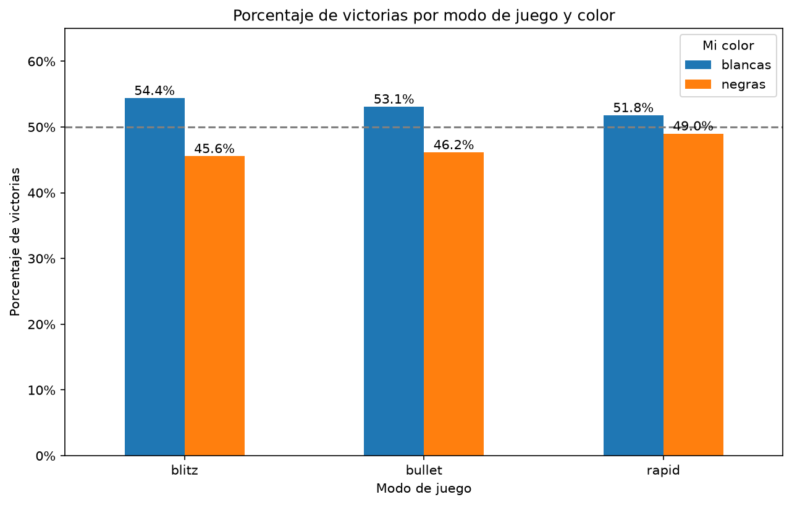
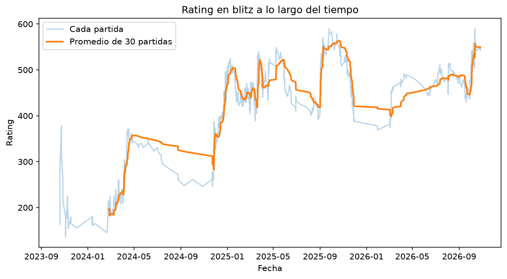
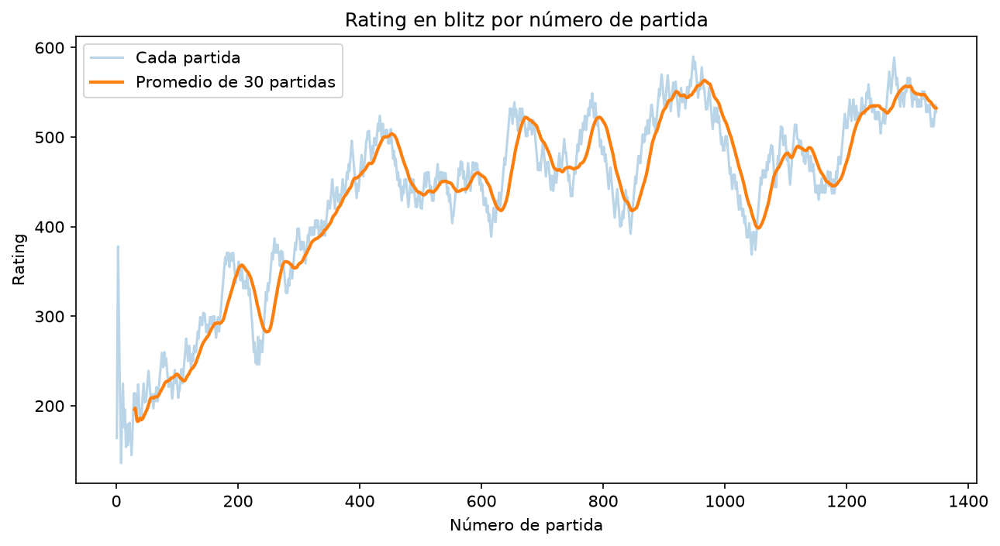
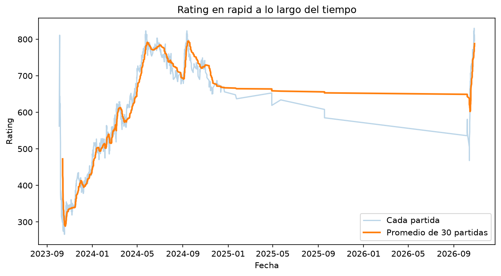
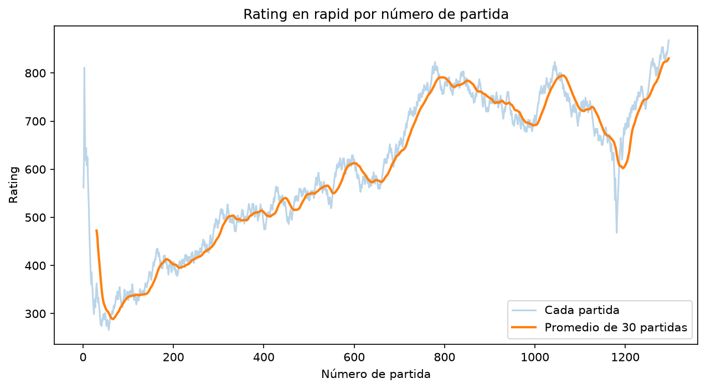
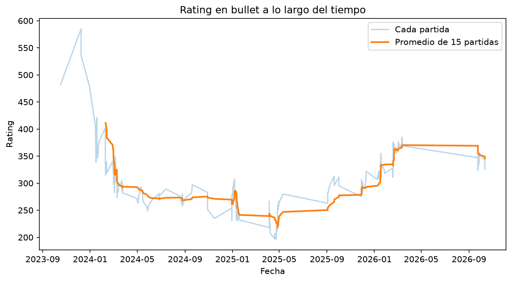
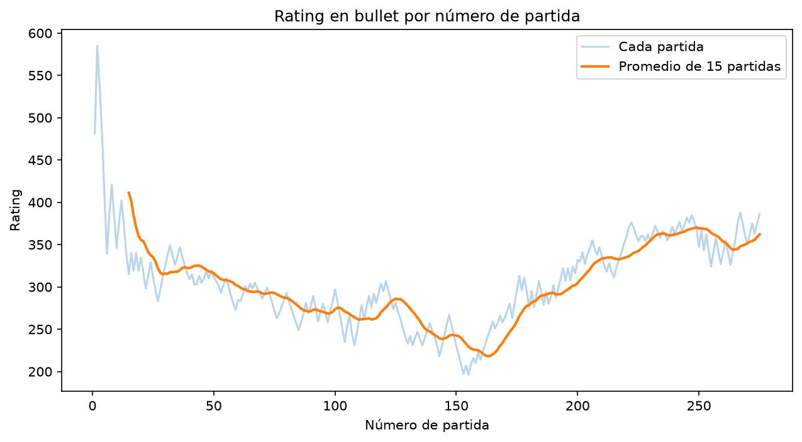
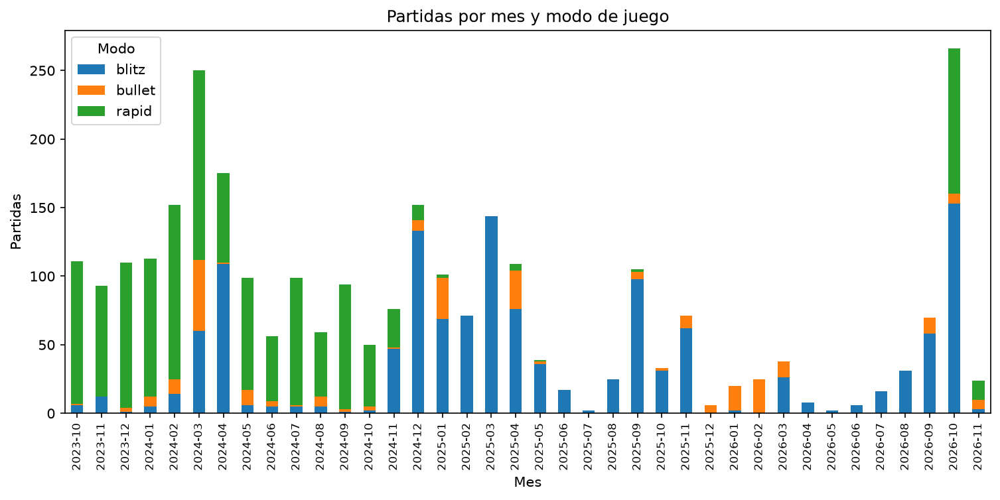

# Ajedrez en datos

*Análisis de mis partidas de Chess.com con Python, pandas y SQL.*

Proyecto de análisis de datos con Python para responder una pregunta simple: **¿dónde pierdo mis partidas?**

Descargo mi historial completo de la API pública de Chess.com, lo limpio con pandas y lo analizo para encontrar patrones en mi forma de jugar: por color, por modo de juego, a lo largo del tiempo, por rachas, por duración de la partida y por hora del día.

> **Estado: en progreso.** Ya tengo el historial completo descargado y limpio, y seis análisis hechos. Lo siguiente es el análisis por apertura y un dashboard interactivo.

## Resumen de los datos

**2,943 partidas** de 38 meses (de octubre de 2023 al 9 de noviembre de 2026), todas con rating y de ajedrez estándar:

| Modo | Partidas |
|---|---|
| Blitz | 1,347 |
| Rapid | 1,300 |
| Bullet | 296 |

## Hallazgo 1: rindo mejor con blancas



| Modo | Partidas con blancas | Victorias con blancas | Partidas con negras | Victorias con negras |
|---|---|---|---|---|
| Blitz | 669 | 54.4% | 678 | 45.6% |
| Bullet | 154 | 54.5% | 142 | 45.1% |
| Rapid | 642 | 52.0% | 658 | 49.1% |

- En los tres modos gano más con blancas que con negras.
- **En blitz la diferencia es la más clara** (unos 9 puntos, con casi 700 partidas por color), y es mayor que el margen de error de esos grupos.
- En rapid (unos 3 puntos) y en bullet (unos 9 puntos, pero con solo 154 y 142 partidas, dentro del margen de error) la tendencia va en la misma dirección, pero con la evidencia actual no puedo afirmar que sea real.
- Con un solo mes de datos (octubre de 2026) vi lo contrario: más victorias con negras. Con el historial completo esa diferencia desapareció, lo que muestra lo engañoso que es sacar conclusiones de una muestra pequeña.

Todavía no sé **por qué** pasa. Una hipótesis por probar es que alguna apertura con negras me cuesta especialmente, pero hoy no guardo la apertura de cada partida.

## Hallazgo 2: mi rating sube jugando, y las pausas distorsionan la lectura por fecha

Cada modo de juego tiene su propio rating en Chess.com, así que los analizo por separado. La línea tenue es el rating después de cada partida y la naranja es el promedio de las últimas 30 partidas (15 en bullet, que tiene pocas). Dibujo cada modo de dos formas: **por fecha** y **por número de partida**, que quita las pausas.

> Las cifras de blitz corresponden a la descarga actual. Las de rapid y bullet las leí con la descarga anterior (2,918 partidas); desde entonces sumé 4 partidas de rapid y 21 de bullet, así que algún valor reciente puede haber cambiado un poco.

### Blitz





- Hay progreso neto: de unos 150-380 en las primeras partidas a unos 530-540 hoy, con picos de unos 560 (en el promedio) hacia las partidas ~965 y ~1300.
- Por fecha parece que subo en escalones. **Por número de partida la subida es continua**: de unos 285 a unos 500 en unas 200 partidas (de la partida ~245 a la ~450). Los "saltos" eran partidas jugadas en pocas semanas, separadas por pausas.
- Después de la partida ~450 avanzo mucho menos: en unas 900 partidas los picos suben poco (de unos 500 a unos 560) y los valles se quedan entre unos 400 y 465.
- Hay **olas** de unos 50 a 165 puntos que suben y bajan cada 120-220 partidas; la mayor es la bajada de unos 560 a unos 400 entre las partidas ~965 y ~1055. Todavía no sé a qué se deben (ver el hallazgo 4: no se explican por rachas de una partida a la siguiente).

### Rapid





- Es mi mejor modo: hoy ronda los 830-870, contra unos 530 en blitz.
- Tras las primeras ~60 partidas de calibración, subí de forma sostenida de unos 290 a unos 790 en unas 700 partidas, y me quedé entre 690 y 820 durante unas 300 más.
- Entre enero de 2025 y septiembre de 2026 jugué solo 10 partidas de rapid. Al volver en octubre de 2026, el rating de las primeras partidas cayó hasta unos 470 y después remontó hasta unos 830-870 en unas 115 partidas. Superé mi máximo anterior (unos 820) y lo hice mucho más rápido que la primera vez (unos +500 puntos en 700 partidas).

### Bullet





- Es el modo con menos partidas (296), así que la línea es ruidosa y no saco conclusiones fuertes.
- Tras unas 10 partidas de calibración (mis dos primeras fueron 482 y 585), el rating baja despacio hasta unos 200 hacia la partida ~150, alrededor de abril de 2025.
- Desde ahí sube hasta unos 370 hacia la partida ~250 (marzo de 2026). El tramo de unos 300 a unos 370 coincide con la racha de bullet de diciembre de 2025 a marzo de 2026. Hoy ronda los 345-385.

### Cómo leer estas gráficas

- Los **primeros días de cada cuenta son poco fiables**: Chess.com ajusta el rating con saltos grandes al principio (en rapid, mis primeras partidas pasan de 562 a 811 y a unos 270 en pocas semanas). Eso es una calibración, no un cambio real de nivel.
- En las gráficas **por fecha**, los tramos rectos largos son pausas sin jugar, no datos que falten, y el promedio se calcula por número de partidas, no por tiempo.
- En las gráficas **por número de partida** desaparecen las pausas, pero se pierde la referencia de cuándo ocurrió cada cosa. Las dos vistas se complementan.

## Hallazgo 3: cambié de modo de juego dos veces



Mi actividad es muy irregular (de 2 a 266 partidas por mes) y, sobre todo, **cambia de modo con el tiempo**:

- **De octubre de 2023 a octubre de 2024 jugaba sobre todo rapid**: unas 1,130 de mis 1,300 partidas de rapid (87%).
- **Desde noviembre de 2024 pasé a blitz**: unas 1,120 de mis 1,347 partidas de blitz son de ahí en adelante.
- Entre enero de 2025 y septiembre de 2026 jugué solo 10 partidas de rapid. En octubre de 2026 volví con 106, y en los primeros nueve días de noviembre llevo 49 partidas (18 de rapid, 28 de bullet y 3 de blitz).
- Bullet va a rachas: marzo de 2024, enero y abril de 2025, de diciembre de 2025 a febrero de 2026 (cuando casi todo lo que jugué fue bullet) y noviembre de 2026.
- Octubre de 2026, con 266 partidas, es el mes con más actividad de todo el historial (el anterior récord eran 250 en marzo de 2024).

Esto explica por qué las gráficas por fecha engañan: **el rating solo se mueve cuando juego**, así que una ráfaga de partidas en pocas semanas se ve como un salto, y una pausa como una línea plana.

## Hallazgo 4: ganar o perder no cambia mi siguiente resultado, pero sí si sigo jugando

Analizo solo **blitz** (1,346 partidas que tienen una partida siguiente).

### No hay evidencia de rachas

| Después de... | Victorias en la siguiente partida | Partidas |
|---|---|---|
| No ganar | 49.3% | 673 |
| Ganar | 50.7% | 673 |

Si me quedo solo con partidas jugadas dentro de la misma sesión (a 30 minutos o menos de la anterior, 707 en total):

| Después de... | Victorias en la siguiente partida | Partidas |
|---|---|---|
| No ganar | 49.5% | 281 |
| Ganar | 50.7% | 426 |

Las diferencias (1.3 y 1.2 puntos) caben de sobra en el ruido de grupos de este tamaño. Con estos datos no puedo decir que una victoria o una derrota cambie mi siguiente resultado. Esto descarta una explicación para las olas de blitz, pero no prueba que sean casualidad, porque solo miro una partida hacia atrás.

### Lo que sí cambia: si sigo jugando

La probabilidad de que mi siguiente partida llegue en menos de 30 minutos depende de cómo terminó la anterior:

| Cómo terminó la partida | Seguí jugando en menos de 30 min | Partidas |
|---|---|---|
| Victoria | 63.3% | 673 |
| Derrota limpia (rendición o mate) | 58.4% | 322 |
| Abandono o tiempo | 22.8% | 316 |
| Empate | 60.0% | 35 |

- **La brecha entre ganar y perder viene sobre todo de las partidas que terminan por abandono o por tiempo**, unos 40 puntos por debajo de las victorias.
- Entre una victoria y una derrota limpia hay unos 5 puntos, y con estos tamaños no es concluyente.
- Los empates son solo 35 partidas, muy pocas para interpretarlos.
- 316 de las 1,346 partidas (23%) terminan por abandono (150) o por tiempo (166), es decir, casi una de cada cuatro.

## Hallazgo 5: los abandonos y los tiempos no son partidas que dejo al empezar

Con el PGN de cada partida cuento cuántas jugadas se jugaron (los tres modos juntos, 2,943 partidas):

| Cómo terminó | Partidas | Jugadas (mediana) |
|---|---|---|
| Victoria | 1,478 | 24 |
| Mate recibido | 251 | 24 |
| Rendición | 584 | 22 |
| Abandono | 314 | 21 |
| Tiempo | 237 | 33 |

- **Los abandonos no se concentran al inicio**: solo la cuarta parte termina antes de la jugada 14, y la mitad pasa de la 21.
- **Los tiempos son partidas largas**: ninguno ocurrió antes de la jugada 11, y tres de cada cuatro pasaron de la 25.
- Por modo, los abandonos duran 18 jugadas de mediana en blitz (150 partidas), 14.5 en bullet (24) y 24 en rapid (140). Los tiempos, 34 en blitz (166) y 30 en bullet (61); en rapid son solo 10, muy pocos para interpretarlos.
- En conjunto, el abandono es el 10.7% de mis partidas y el tiempo el 8.1%: casi una de cada cinco (18.7%).

Esto descarta mi hipótesis inicial de que fueran interrupciones tempranas. No sé **por qué** ocurren: una interrupción puede llegar en cualquier momento, y también cabe que abandone cuando la partida ya va mal. Distinguirlo exigiría evaluar las posiciones con un motor de ajedrez.

## Hallazgo 6: más abandonos y tiempos hacia el mediodía

La hora es la de **fin** de cada partida, en horario de Ciudad de México.

| Franja | Partidas | Victorias | Terminan por abandono o tiempo |
|---|---|---|---|
| Madrugada 0-5 | 879 | 51.1% | 16.8% |
| Mañana 6-9 | 69 | 47.8% | 27.5% |
| Mediodía 10-14 | 227 | 41.4% | 37.0% |
| Tarde 15-18 | 653 | 50.1% | 19.9% |
| Noche 19-23 | 1,115 | 51.6% | 15.2% |

- **El porcentaje de victorias no cambia de forma clara con la hora** en las franjas con muchas partidas. La bajada del mediodía es en gran parte mecánica: un abandono o un tiempo cuentan como derrota.
- Comparando solo **blitz**, para que el modo de juego no mezcle el resultado (en rapid casi nunca se acaba el reloj):

| Franja (blitz) | Partidas | Abandono o tiempo | Abandono | Tiempo |
|---|---|---|---|---|
| Madrugada 0-5 | 323 | 18.3% | 9.6% | 8.7% |
| Mañana 6-9 | 54 | 31.5% | 18.5% | 13.0% |
| Mediodía 10-14 | 178 | 38.8% | 18.0% | 20.8% |
| Tarde 15-18 | 322 | 24.5% | 11.2% | 13.4% |
| Noche 19-23 | 470 | 19.6% | 8.7% | 10.9% |

- En blitz, el mediodía queda unos 14 puntos por encima de la tarde y unos 19 por encima de la noche, y los dos tipos de corte (abandono y tiempo) suben.
- Las victorias en blitz por franja van de 41.0% al mediodía a 53.9% en la madrugada y 52.1% por la noche. La bajada del mediodía es en buena parte mecánica: un abandono o un tiempo cuentan como derrota, y justo ahí hay más.
- **Pero casi todo el mediodía es de 2025.** En ese año, las partidas de blitz cortadas fueron 40.1% al mediodía (142 partidas), 26.5% por la tarde (181), 25.0% en la madrugada (56) y 19.0% por la noche (221). En 2024 y 2026 hay muy pocas partidas al mediodía (21 y 14) para comparar.

Lo trato como **una pista, no como una conclusión**: elegí la franja después de ver los datos, el efecto se apoya en un solo año, y podría reflejar una época concreta (un horario, un periodo de clases) y no la hora en sí.

## Preguntas abiertas

- ¿Por qué abandono o se me acaba el tiempo? ¿Son interrupciones, o dejo la partida cuando ya va mal? Evaluar las posiciones con un motor permitiría separarlo.
- ¿Por qué hay más abandonos y tiempos hacia el mediodía, y por qué sobre todo en 2025?
- ¿A qué se deben las olas de hasta unos 165 puntos en blitz, si no son rachas de una partida a la siguiente?
- ¿Por qué la recuperación de rapid en octubre de 2026 fue tan rápida y llegó a un máximo nuevo? Dos hipótesis sin comprobar: que el blitz de ese año me haya mejorado, o un efecto del sistema de rating tras mucho tiempo de inactividad.
- ¿Por qué rindo mejor con blancas, sobre todo en blitz?

## SQL: las mismas preguntas con otra herramienta

`cargar_sqlite.py` guarda los datos limpios en una base SQLite (`partidas.db`), `consultas.sql` reúne consultas que reproducen varios de los análisis hechos con pandas, y `ejecutar_consultas.py` las corre todas y muestra los resultados.

| Consulta | Qué calcula | Técnicas de SQL | Reproduce |
|---|---|---|---|
| 1 y 1b | Victorias por modo y color, y solo en blitz | `GROUP BY`, `AVG`, `WHERE` | Hallazgo 1 |
| 2 y 2b | Victorias y abandonos o tiempos por franja del día, y solo en blitz | `CASE WHEN`, `IN` | Hallazgo 6 |
| 3 | Victorias según el resultado de la partida anterior | CTE, `LAG`, `IS NOT NULL` | Hallazgo 4 |
| 4 | Promedio móvil de 30 partidas del rating en blitz | `ROW_NUMBER`, `AVG() OVER (... ROWS BETWEEN ...)` | Gráficas de rating |
| 5 | Si sigo jugando en menos de 30 minutos según cómo terminó la partida | CTE, `LEAD`, `strftime`, `CASE WHEN` | Hallazgo 4 |

Las consultas 1, 1b, 2, 2b, 3 y 5 dan los mismos números que pandas (por ejemplo, 669 partidas de blitz con blancas y 54.4% de victorias, o 227 partidas al mediodía con 37.0% de abandonos o tiempos). El último valor de la consulta 4 (532.5) es consistente con el final de la línea naranja de la gráfica de blitz.

Un ejemplo, la consulta 3, que hace en SQL lo que `shift(1)` hace en pandas:

```sql
WITH blitz AS (
    SELECT
        gane,
        LAG(gane) OVER (ORDER BY fecha) AS gane_anterior
    FROM partidas
    WHERE time_class = 'blitz'
)
SELECT
    gane_anterior,
    COUNT(*) AS partidas,
    ROUND(AVG(gane) * 100, 1) AS pct_victorias
FROM blitz
WHERE gane_anterior IS NOT NULL
GROUP BY gane_anterior
ORDER BY gane_anterior;
```

Decisiones al cargar los datos: el mes y la hora se calculan en pandas, en hora de Ciudad de México, y la fecha se guarda como texto sin desfase, para que las funciones de fecha de SQLite no la conviertan a UTC. El PGN no se carga porque pesa mucho y estas consultas no lo necesitan.

## Qué hace el proyecto

1. `explorar.py` consulta la API pública de Chess.com, descarga mis partidas mes por mes y extrae los datos desde mi perspectiva: mi color, mi rating, el del rival, mi resultado, el modo de juego, las reglas y el PGN.
2. Convierte las fechas de UTC a la hora de Ciudad de México y clasifica los resultados de Chess.com (`win`, `resigned`, `timeout`, `abandoned`...) en victoria, derrota o empate.
3. Verifica que no haya duplicados ni resultados sin clasificar, y guarda todo en `partidas.csv`.
4. `analisis.py` lee ese CSV, filtra y genera las tablas y gráficas: victorias por modo y color, rating por modo (por fecha y por número de partida) y partidas por mes y modo.
5. `rachas.py` analiza, en blitz, si el resultado de una partida influye en la siguiente y en si sigo jugando.
6. `abandonos.py` cuenta las jugadas de cada partida a partir del PGN y estudia los abandonos, los tiempos y la hora del día.
7. `cargar_sqlite.py` guarda los datos limpios en una base SQLite (`partidas.db`) para poder analizarlos también con SQL.
8. `ejecutar_consultas.py` corre las consultas de `consultas.sql` sobre esa base y muestra los resultados.

## Decisiones de análisis

- Los **empates cuentan como "no ganó"** al calcular el porcentaje de victorias.
- `abandoned`, `timeout`, `resigned` y `checkmated` se agrupan como **derrota**. Conservo la columna original (`mi_resultado`) para poder analizar cada tipo por separado. Aquí `abandoned` significa que abandoné yo, y `timeout` que se me acabó el tiempo.
- Excluyo las partidas **daily** (10 de 2,953) por ser muy pocas y de ritmo muy distinto. Esto también deja fuera la única partida de ajedrez 960.
- Analizo **cada modo por separado**, porque cada uno tiene su propio rating.
- Los meses y las horas se cuentan en **hora de Ciudad de México**, no en UTC.
- Una partida pertenece a la **misma sesión** que la anterior si terminó 30 minutos o menos después. La hora es la de fin de cada partida, así que el intervalo incluye lo que dura la siguiente.
- Para contar jugadas leo el PGN, me quedo con la parte posterior al encabezado, borro los comentarios del reloj y tomo el número de jugada más alto.

## Cómo correrlo

Requiere Python 3. Instrucciones para Windows:

```
git clone https://github.com/edgarrr-45/ajedrez-en-datos.git
cd ajedrez-en-datos
py -m venv venv
venv\Scripts\activate
pip install -r requirements.txt
py explorar.py
py analisis.py
py rachas.py
py abandonos.py
py cargar_sqlite.py
py ejecutar_consultas.py
```

Para analizar otra cuenta, cambia `USUARIO` al inicio de `explorar.py` por un usuario de Chess.com en minúsculas. La variable `ULTIMOS_MESES` controla cuántos meses descarga (`None` baja todo el historial). Los datos descargados quedan en `partidas.csv`, que no se sube al repositorio. Las gráficas se guardan como PNG en la carpeta `imagenes`.

## Tecnologías

- Python
- `requests`, para consumir la API pública de Chess.com
- `pandas`, para la limpieza y el análisis
- `matplotlib`, para las gráficas
- SQLite (`sqlite3`), para guardar los datos y consultarlos con SQL

## Plan

- [x] Conectar con la API y descargar el historial completo
- [x] Extraer datos desde mi perspectiva (color, ratings, resultado, modo)
- [x] Convertir fechas y clasificar resultados
- [x] Guardar los datos localmente en un CSV
- [x] Comparar victorias por color y modo de juego
- [x] Evolución del rating en el tiempo, por modo de juego
- [x] Partidas por mes y por modo de juego
- [x] Rating por número de partida, sin el efecto de las pausas
- [x] Rachas: ¿una victoria o una derrota cambia mi siguiente resultado?
- [x] Partidas abandonadas y por tiempo: cuántas jugadas llevaban al terminar
- [x] Rendimiento por hora del día
- [x] Cargar los datos en una base SQLite
- [x] Consultas SQL que reproducen estos análisis (`consultas.sql`)
- [ ] Análisis por apertura
- [ ] Dashboard interactivo con Streamlit: que cualquier jugador escriba su usuario, vea sus estadísticas y elija una partida para analizarla (posiblemente con un motor de ajedrez)

## Datos

Todos los datos vienen de la [API pública de Chess.com](https://www.chess.com/news/view/published-data-api). El proyecto hace las peticiones en serie y con pausas para respetar sus límites.

## Autor

Edgar · [GitHub: edgarrr-45](https://github.com/edgarrr-45)