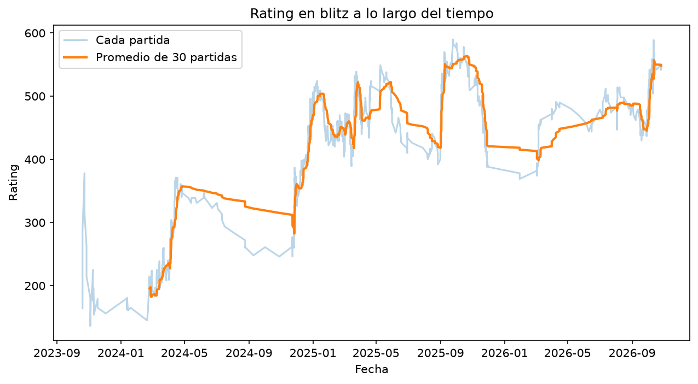
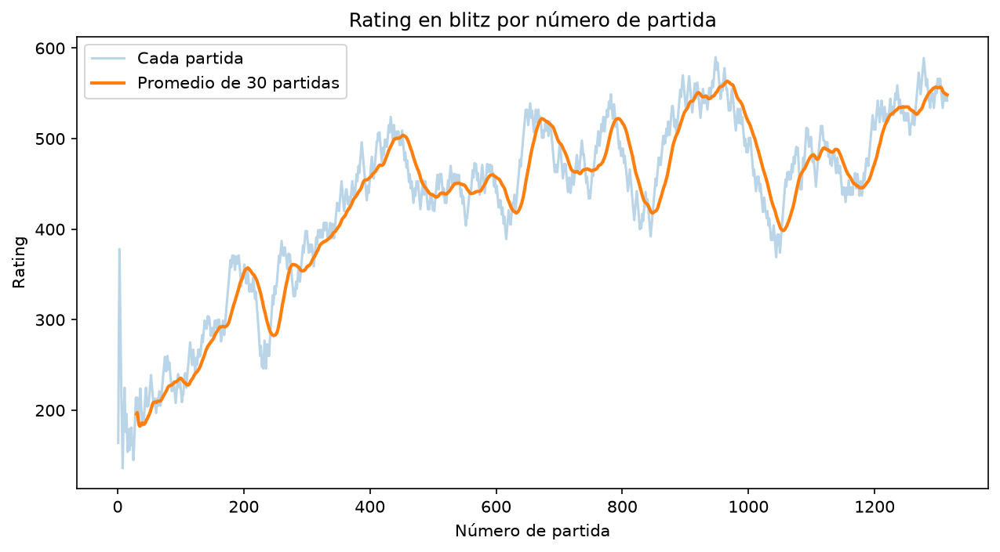
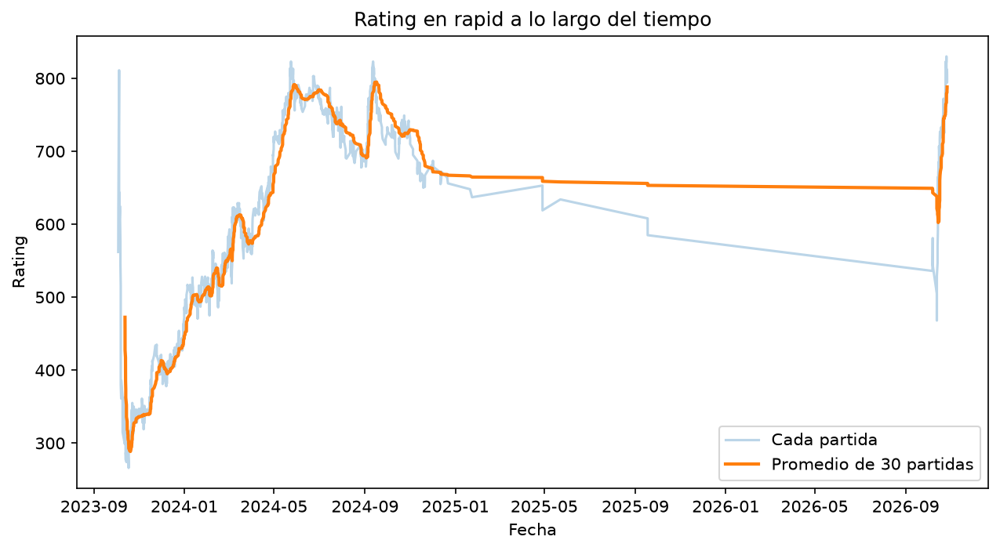
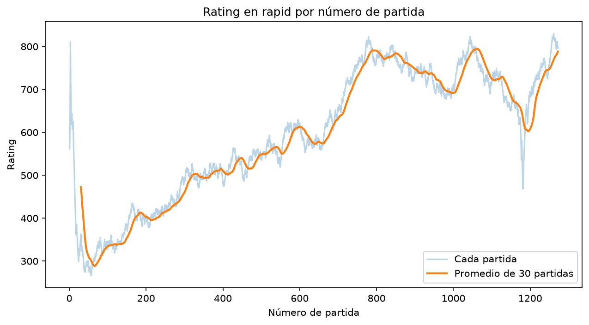
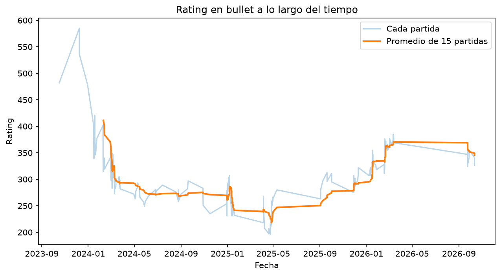
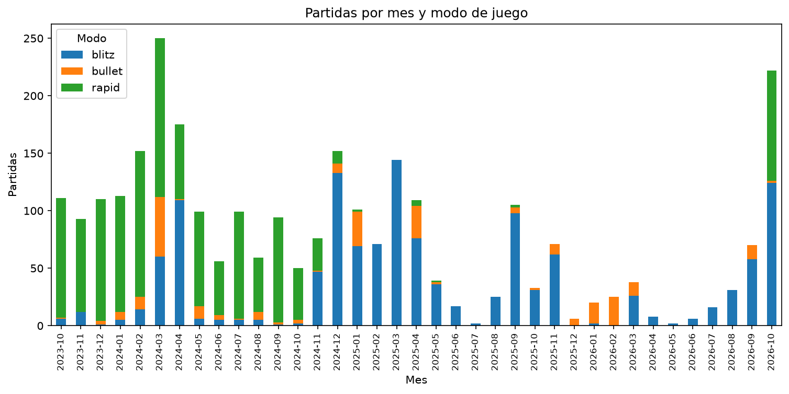

# Análisis de mis partidas de Chess.com

Proyecto de análisis de datos con Python para responder una pregunta simple: **¿dónde pierdo mis partidas?**

Descargo mi historial completo de la API pública de Chess.com, lo limpio con pandas y lo analizo para encontrar patrones en mi forma de jugar: por color, por modo de juego, a lo largo del tiempo y, más adelante, por rachas, hora del día y apertura.

> **Estado: en progreso.** Ya tengo el historial completo descargado y limpio, y tres análisis hechos: victorias por color, evolución del rating y actividad por mes y modo. Lo siguiente es estudiar las rachas, investigar por qué ocurren algunos cambios y construir un dashboard.

## Resumen de los datos

**2,850 partidas** de 37 meses (octubre de 2023 a octubre de 2026), todas con rating y de ajedrez estándar:

| Modo | Partidas |
|---|---|
| Blitz | 1,315 |
| Rapid | 1,272 |
| Bullet | 263 |

## Hallazgo 1: rindo mejor con blancas


| Modo | Partidas con blancas | Victorias con blancas | Partidas con negras | Victorias con negras |
|---|---|---|---|---|
| Blitz | 651 | 54.1% | 664 | 46.1% |
| Bullet | 138 | 52.2% | 125 | 45.6% |
| Rapid | 630 | 51.4% | 642 | 48.8% |

- En los tres modos gano más con blancas que con negras.
- **En blitz la diferencia es la más clara** (unos 8 puntos, con más de 650 partidas por color).
- En rapid (unos 3 puntos) y en bullet (pocas partidas) la tendencia va en la misma dirección, pero con la evidencia actual no puedo afirmar que sea real.
- Con un solo mes de datos (octubre de 2026) vi lo contrario: más victorias con negras. Con el historial completo esa diferencia desapareció, lo que muestra lo engañoso que es sacar conclusiones de una muestra pequeña.

Todavía no sé **por qué** pasa. Una hipótesis por probar es que alguna apertura con negras me cuesta especialmente, pero hoy no guardo la apertura de cada partida.

## Hallazgo 2: mi rating sube jugando, y las pausas distorsionan la lectura por fecha

Cada modo de juego tiene su propio rating en Chess.com, así que los analizo por separado. La línea tenue es el rating después de cada partida y la naranja es el promedio de las últimas 30 partidas (15 en bullet, que tiene pocas). Dibujo cada modo de dos formas: **por fecha** y **por número de partida**, que quita las pausas.

### Blitz





- Hay progreso neto: de unos 150-380 en las primeras partidas a unos 540-550 hoy.
- Por fecha parece que subo en escalones. **Por número de partida la subida es continua**: de unos 285 a unos 500 en unas 200 partidas (de la partida ~245 a la ~450). Los "saltos" eran partidas jugadas en pocas semanas, separadas por pausas.
- Después de la partida ~450 casi no avanzo: en unas 850 partidas oscilo entre unos 400 y unos 560.
- Hay **olas** de entre 80 y 160 puntos que suben y bajan cada 100-200 partidas. Todavía no sé a qué se deben.

### Rapid





- Es mi mejor modo: hoy ronda los 800, contra unos 550 en blitz.
- Tras las primeras ~60 partidas de calibración, subí de forma sostenida de unos 290 a unos 790 en unas 700 partidas, y me quedé entre 690 y 820 durante unas 300 más.
- Entre enero de 2025 y septiembre de 2026 jugué solo 10 partidas de rapid. Al volver en octubre de 2026, el rating de las primeras partidas cayó hasta unos 470 y después remontó hasta unos 830 en unas 90 partidas, recuperando mi mejor nivel mucho más rápido que la primera vez.

### Bullet



- Es el modo con menos partidas (263), así que la línea es ruidosa y no saco conclusiones fuertes.
- Cayó de unos 400-585 al inicio a unos 200 hacia abril de 2025, y se recuperó a unos 330-370 en 2026.

### Cómo leer estas gráficas

- Los **primeros días de cada cuenta son poco fiables**: Chess.com ajusta el rating con saltos grandes al principio (en rapid, mis primeras partidas pasan de 562 a 811 y a unos 270 en pocas semanas). Eso es una calibración, no un cambio real de nivel.
- En las gráficas **por fecha**, los tramos rectos largos son pausas sin jugar, no datos que falten, y el promedio se calcula por número de partidas, no por tiempo.
- En las gráficas **por número de partida** desaparecen las pausas, pero se pierde la referencia de cuándo ocurrió cada cosa. Las dos vistas se complementan.

## Hallazgo 3: cambié de modo de juego dos veces



Mi actividad es muy irregular (de 2 a 250 partidas por mes) y, sobre todo, **cambia de modo con el tiempo**:

- **De octubre de 2023 a octubre de 2024 jugaba sobre todo rapid**: unas 1,130 de mis 1,272 partidas de rapid, casi 9 de cada 10.
- **Desde noviembre de 2024 pasé a blitz**: unas 1,080 de mis 1,315 partidas de blitz son de ahí en adelante.
- Entre enero de 2025 y septiembre de 2026 jugué solo 10 partidas de rapid. En octubre de 2026 volví con 96.
- Bullet va a rachas: marzo de 2024, enero y abril de 2025, y de diciembre de 2025 a febrero de 2026, cuando casi todo lo que jugué fue bullet.
- Octubre de 2026 todavía no termina (los datos llegan hasta el 27), y ya es el segundo mes con más partidas del historial.

Esto explica por qué las gráficas por fecha engañan: **el rating solo se mueve cuando juego**, así que una ráfaga de partidas en pocas semanas se ve como un salto, y una pausa como una línea plana.

### Preguntas abiertas

- ¿A qué se deben las olas de 80 a 160 puntos en blitz? ¿Son rachas de victorias y derrotas, o cambios en cómo juego?
- ¿Por qué la recuperación de rapid en octubre de 2026 fue tan rápida? Dos hipótesis sin comprobar: que el blitz de ese año me haya mejorado, o un efecto del sistema de rating tras mucho tiempo de inactividad.
- ¿Por qué rindo mejor con blancas, sobre todo en blitz?

## Qué hace el proyecto

1. `explorar.py` consulta la API pública de Chess.com, descarga mis partidas mes por mes y extrae los datos desde mi perspectiva: mi color, mi rating, el del rival, mi resultado, el modo de juego y las reglas.
2. Convierte las fechas de UTC a la hora de Ciudad de México y clasifica los resultados de Chess.com (`win`, `resigned`, `timeout`, `abandoned`...) en victoria, derrota o empate.
3. Verifica que no haya duplicados ni resultados sin clasificar, y guarda todo en `partidas.csv`.
4. `analisis.py` lee ese CSV, filtra y genera las tablas y gráficas: victorias por modo y color, rating por modo (por fecha y por número de partida) y partidas por mes y modo.

## Decisiones de análisis

- Los **empates cuentan como "no ganó"** al calcular el porcentaje de victorias.
- `abandoned`, `timeout`, `resigned` y `checkmated` se agrupan como **derrota**. Conservo la columna original (`mi_resultado`) para poder analizar cada tipo por separado.
- Excluyo las partidas **daily** (10 de 2,860) por ser muy pocas y de ritmo muy distinto. Esto también deja fuera la única partida de ajedrez 960.
- Analizo **cada modo por separado**, porque cada uno tiene su propio rating.
- Los meses se cuentan en **hora de Ciudad de México**, no en UTC.

## Cómo correrlo

Requiere Python 3. Instrucciones para Windows:

```
git clone https://github.com/edgarrr-45/analisis-ajedrez.git
cd analisis-ajedrez
py -m venv venv
venv\Scripts\activate
pip install -r requirements.txt
py explorar.py
py analisis.py
```

Para analizar otra cuenta, cambia `USUARIO` al inicio de `explorar.py` por un usuario de Chess.com en minúsculas. La variable `ULTIMOS_MESES` controla cuántos meses descarga (`None` baja todo el historial). Los datos descargados quedan en `partidas.csv`, que no se sube al repositorio. Las gráficas se guardan como PNG en la carpeta del proyecto.

## Tecnologías

- Python
- `requests`, para consumir la API pública de Chess.com
- `pandas`, para la limpieza y el análisis
- `matplotlib`, para las gráficas

## Plan

- [x] Conectar con la API y descargar el historial completo
- [x] Extraer datos desde mi perspectiva (color, ratings, resultado, modo)
- [x] Convertir fechas y clasificar resultados
- [x] Guardar los datos localmente en un CSV
- [x] Comparar victorias por color y modo de juego
- [x] Evolución del rating en el tiempo, por modo de juego
- [x] Partidas por mes y por modo de juego
- [x] Rating por número de partida, sin el efecto de las pausas
- [ ] Rachas: ¿gano más después de ganar y pierdo más después de perder?
- [ ] Rendimiento por hora del día
- [ ] Análisis por apertura
- [ ] Investigar las partidas abandonadas
- [ ] Dashboard interactivo con Streamlit

## Datos

Todos los datos vienen de la [API pública de Chess.com](https://www.chess.com/news/view/published-data-api). El proyecto hace las peticiones en serie y con pausas para respetar sus límites.

## Autor

Edgar · [GitHub: edgarrr-45](https://github.com/edgarrr-45)