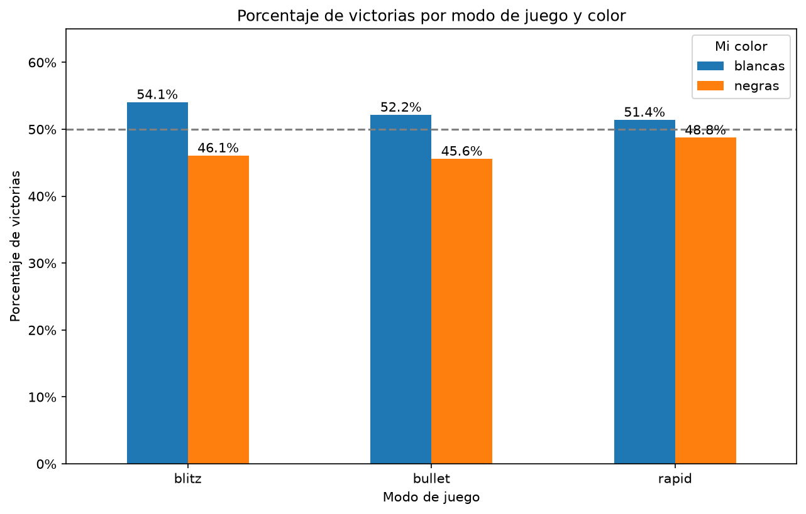

# Análisis de mis partidas de Chess.com

Proyecto de análisis de datos con Python para responder una pregunta simple: **¿dónde pierdo mis partidas?**

Descargo mi historial completo de la API pública de Chess.com, lo limpio con pandas y lo analizo para encontrar patrones en mi forma de jugar: por color, por modo de juego, por hora del día, por rachas y por tipo de derrota.

> **Estado: en progreso.** Ya tengo el historial completo descargado y limpio, y el primer análisis hecho. Lo siguiente es la evolución de mi rating en el tiempo y un dashboard.

## Hallazgo principal: rindo mejor con blancas

Analicé **2,850 partidas** (37 meses, de octubre de 2023 a octubre de 2026), todas con rating, en blitz, rapid y bullet.



| Modo | Partidas con blancas | Victorias con blancas | Partidas con negras | Victorias con negras |
|---|---|---|---|---|
| Blitz | 651 | 54.1% | 664 | 46.1% |
| Bullet | 138 | 52.2% | 125 | 45.6% |
| Rapid | 630 | 51.4% | 642 | 48.8% |

- En los tres modos gano más con blancas que con negras.
- **En blitz la diferencia es la más clara** (unos 8 puntos, con más de 650 partidas por color).
- En rapid (unos 3 puntos) y en bullet (pocas partidas) la tendencia va en la misma dirección, pero con la evidencia actual no puedo afirmar que sea real.
- Con un solo mes de datos (octubre de 2026) vi lo contrario: más victorias con negras. Con el historial completo esa diferencia desapareció, lo que muestra lo engañoso que es sacar conclusiones de una muestra pequeña.

Todavía no sé **por qué** pasa. Una hipótesis por probar es que alguna apertura con negras me cuesta especialmente, pero hoy no guardo la apertura de cada partida.

## Qué hace el proyecto

1. `explorar.py` consulta la API pública de Chess.com, descarga mis partidas mes por mes y extrae los datos desde mi perspectiva: mi color, mi rating, el del rival, mi resultado, el modo de juego y las reglas.
2. Convierte las fechas de UTC a la hora de Ciudad de México y clasifica los resultados de Chess.com (`win`, `resigned`, `timeout`, `abandoned`...) en victoria, derrota o empate.
3. Verifica que no haya duplicados ni resultados sin clasificar, y guarda todo en `partidas.csv`.
4. `analisis.py` lee ese CSV, filtra y calcula el porcentaje de victorias por modo y color.

## Decisiones de análisis

- Los **empates cuentan como "no ganó"** al calcular el porcentaje de victorias.
- `abandoned`, `timeout`, `resigned` y `checkmated` se agrupan como **derrota**. Conservo la columna original (`mi_resultado`) para poder analizar cada tipo por separado.
- Excluyo las partidas **daily** (10 de 2,860) por ser muy pocas y de ritmo muy distinto. Esto también deja fuera la única partida de ajedrez 960.
- Analizo **cada modo por separado**, porque Chess.com mantiene un rating distinto para blitz, rapid y bullet.

## Cómo correrlo

Requiere Python 3. Instrucciones para Windows:

```
git clone https://github.com/edgarrr-45/analisis-ajedrez.git
cd analisis-ajedrez
py -m venv venv
venv\Scripts\activate
pip install -r requirements.txt
py explorar.py
py analisis.py
```

Para analizar otra cuenta, cambia `USUARIO` al inicio de `explorar.py` por un usuario de Chess.com en minúsculas. La variable `ULTIMOS_MESES` controla cuántos meses descarga (`None` baja todo el historial). Los datos descargados quedan en `partidas.csv`, que no se sube al repositorio.

## Tecnologías

- Python
- `requests`, para consumir la API pública de Chess.com
- `pandas`, para la limpieza y el análisis
- `matplotlib`, para las gráficas

## Plan

- [x] Conectar con la API y descargar el historial completo
- [x] Extraer datos desde mi perspectiva (color, ratings, resultado, modo)
- [x] Convertir fechas y clasificar resultados
- [x] Guardar los datos localmente en un CSV
- [x] Comparar victorias por color y modo de juego
- [ ] Evolución del rating en el tiempo, por modo de juego
- [ ] Rendimiento por hora del día y por rachas
- [ ] Análisis por apertura
- [ ] Investigar las partidas abandonadas
- [ ] Dashboard interactivo con Streamlit

## Datos

Todos los datos vienen de la [API pública de Chess.com](https://www.chess.com/news/view/published-data-api). El proyecto hace las peticiones en serie y con pausas para respetar sus límites.

## Autor

Edgar · [GitHub: edgarrr-45](https://github.com/edgarrr-45)